<div align="center">

  

  # 🏪 SyncStore
  ### Modern Dual-Platform Point-of-Sale (POS) & Workforce Management Ecosystem

  <p align="center">
    A unified, cloud-synchronized platform designed for fast-paced retail and part-time business operations. Combines an ultra-responsive <strong>React Native mobile terminal</strong> for staff on the floor with a rich <strong>Next.js 16 web control center</strong> for store managers.
  </p>

  <p align="center">
    <a href="https://syncstore-parttime.vercel.app/"></a>
    <a href="https://rookieenough.github.io/Orion-Data/redirect.html?id=parttime&icon=https%3A%2F%2Fraw.githubusercontent.com%2FArunaK-netizen%2FRasagna_Parttime%2Fmain%2Fmobile%2Fassets%2Fimages%2Ficon.png"></a>
    <a href="https://github.com/ArunaK-netizen/Rasagna_Parttime/releases"></a>
  </p>

  <p align="center">
    
    
    
    
    
    
    
  </p>

  <p align="center">
    <a href="#-quick-links--downloads">Quick Links</a> •
    <a href="#-features-deep-dive">Key Features</a> •
    <a href="#-visual-showcase">Screenshots</a> •
    <a href="#-architecture--data-flow">Architecture</a> •
    <a href="#-tech-stack">Tech Stack</a> •
    <a href="#-getting-started">Getting Started</a> •
    <a href="#-ci--cd-pipeline">CI/CD & Releases</a>
  </p>

</div>

---

## 🔗 Quick Links & Downloads

| Target | Channel / URL | Description |
| :--- | :--- | :--- |
| 🌐 **Admin Web Portal** | [**syncstore-parttime.vercel.app**](https://syncstore-parttime.vercel.app/) | Live production management dashboard hosted on Vercel |
| 📱 **Orion Store App** | [**Install via Orion Store**](https://rookieenough.github.io/Orion-Data/redirect.html?id=parttime&icon=https%3A%2F%2Fraw.githubusercontent.com%2FArunaK-netizen%2FRasagna_Parttime%2Fmain%2Fmobile%2Fassets%2Fimages%2Ficon.png) | One-click install for the Android mobile application |
| 📦 **GitHub Releases** | [**Download Latest Android APK**](https://github.com/ArunaK-netizen/Rasagna_Parttime/releases) | Prebuilt, signed production APK binaries built by automated CI |
| 📂 **Source Code** | [**GitHub Repository**](https://github.com/ArunaK-netizen/Rasagna_Parttime) | Official GitHub repository |

---

## 📖 Overview

Small businesses, pop-up stores, and part-time teams often struggle with fragmented operations: shift hours tracked in messaging apps, sales entered onto paper or disconnected cash registers, and inventory balances reconciled days later on spreadsheets.

**SyncStore** replaces this friction with an end-to-end synchronized ecosystem:
- **Instant Floor POS**: Mobile terminals allow cashiers to assemble multi-item orders, apply category discounts, calculate dynamic taxes, record cash/card/UPI payments, and issue digital receipts.
- **Real-Time Data Mirroring**: Powered by Google Cloud Firestore listeners (`onSnapshot`), every transaction, shift update, or inventory adjustment is mirrored immediately between web and mobile devices.
- **Empowered Staff**: Employees track upcoming shifts, check store announcements, monitor personal earnings, and compete on friendly performance leaderboards.
- **Executive Oversight**: Store owners inspect live turnover graphs, configure products, approve employee access requests, and export financial reports to Excel or PDF with one click.

---

## ✨ Features Deep Dive

### 📱 Staff Mobile Experience (`/mobile`)
*Crafted with Expo Router, React Native 0.81, and NativeWind for snappy tactile feedback on Android and iOS.*

- ⚡ **Point-of-Sale (POS) Terminal**:
  - Intuitive product grid with fast category chips and search filtering.
  - Interactive cart drawer with item counter increment/decrement controls.
  - Multi-tender payment capture (Cash, Card, UPI) with optional gratuity/tip logging.
  - Real-time tax computation engine and total amount calculation.
- 🖨️ **Digital Receipts & Sharing**:
  - Export printable receipts directly using `expo-print`.
  - Share transaction records natively to customers or accounting via `expo-sharing`.
- 📅 **Shift & Calendar Hub**:
  - Integrated shift planner (`react-native-calendars`) displaying assigned work dates.
  - Clear start/end times and supervisor notes for each shift.
- 🏆 **Gamified Sales Leaderboard**:
  - Real-time rankings showing top-performing staff members based on sales revenue and item counts.
  - Encourages team performance and friendly competition.
- 📢 **Company Broadcasts**:
  - Instant company-wide notice board with unread badge indicators so staff never miss critical updates.
- 🔐 **Secure Request-Based Onboarding**:
  - Google Sign-In and email authentication.
  - Whitelist security gate: newly joined staff submit access requests and remain in a pending state until approved by an administrator.
- 🎛️ **In-App Supervisor Tools**:
  - Authorized managers can toggle administrative views directly inside the mobile app to edit products or review transactions on the move.

---

### 💻 Web Admin Control Center (`/admin`)
*Built on Next.js 16 (App Router), React 19, and Tailwind CSS v4 for desktop-class operational efficiency.*

- 📊 **Executive Overview & KPIs**:
  - High-level metric cards for Gross Revenue, Daily Orders, Active Staff, and Product Counts.
  - Interactive revenue velocity and trend charts powered by `recharts`.
- 📦 **Product & Inventory Catalog**:
  - Full CRUD operations: create, modify, categorize, and archive products.
  - Dynamic price assignment and category tagging across multiple store workspaces.
- 👥 **Workforce & Access Management**:
  - Approval queue for incoming employee sign-up requests (`pending`, `approved`, `rejected`).
  - Granular role provisioning (Admin vs. Staff) and whitelist verification.
- 🗓️ **Shift Scheduling System**:
  - Assign custom shift hours (24h format), dates, and operational notes to team members.
  - Syncs instantaneously to the mobile shift view.
- 🧾 **Audit Logs & Export Engine**:
  - Searchable and filterable transaction history with line-item drilldowns.
  - **1-Click PDF Export**: Clean, printable invoices and transaction summaries via `jspdf` and `jspdf-autotable`.
  - **1-Click Excel Export**: Download raw accounting datasets (`.xlsx`) via `xlsx`.
- 📣 **Broadcast Center**:
  - Compose store-wide announcements pushed in real-time to all staff mobile devices.

---

## 📸 Visual Showcase

### 📱 Staff Mobile Application
<div align="center">
  <table>
    <tr>
      <td width="25%" align="center"><b>POS Catalog & Terminal</b></td>
      <td width="25%" align="center"><b>Cart & Tender Checkout</b></td>
      <td width="25%" align="center"><b>Shift Schedule</b></td>
      <td width="25%" align="center"><b>Gamified Leaderboard</b></td>
    </tr>
    <tr>
      <td>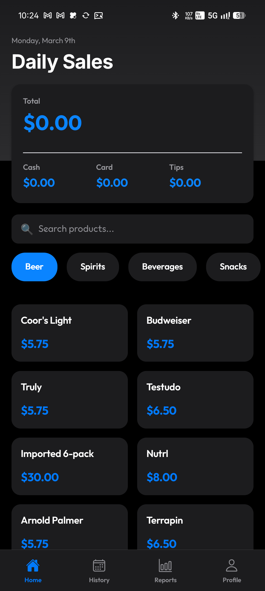</td>
      <td>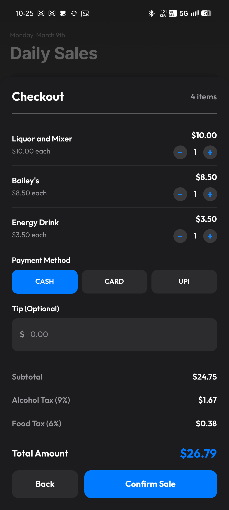</td>
      <td>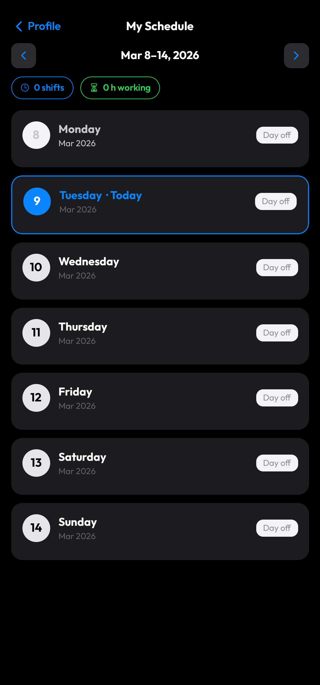</td>
      <td></td>
    </tr>
    <tr>
      <td width="25%" align="center"><b>Sales History & Logs</b></td>
      <td width="25%" align="center"><b>Visual Sales Analytics</b></td>
      <td width="25%" align="center"><b>Detailed Export & Reports</b></td>
      <td width="25%" align="center"><b>Staff Profile & Hours</b></td>
    </tr>
    <tr>
      <td>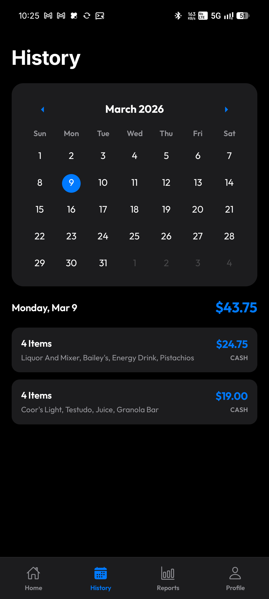</td>
      <td>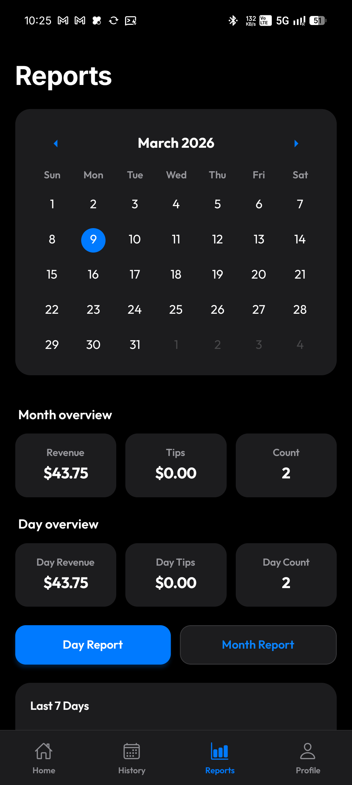</td>
      <td>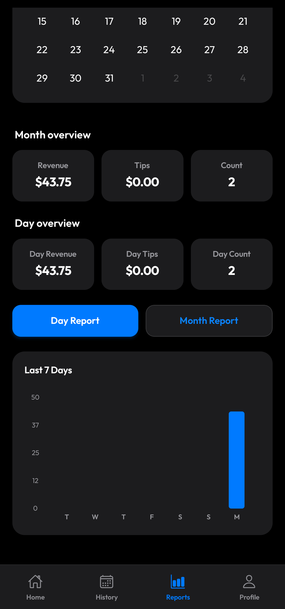</td>
      <td>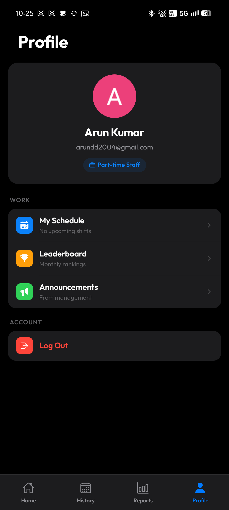</td>
    </tr>
  </table>

  <br/>
  <p align="center">
    <b>👑 Floor Manager Mobile Console</b> (In-app management controls & store settings)<br/>
    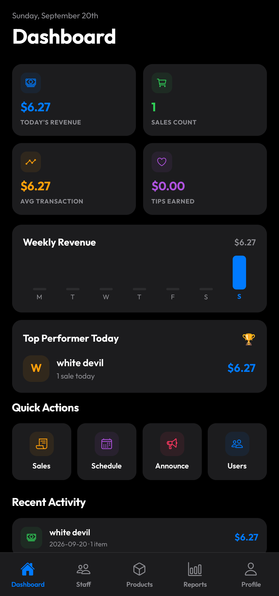
  </p>
</div>

<br/>

### 💻 Web Management Portal
<div align="center">
  <table>
    <tr>
      <td colspan="2" align="center"><b>Command Center Dashboard Overview</b></td>
    </tr>
    <tr>
      <td colspan="2">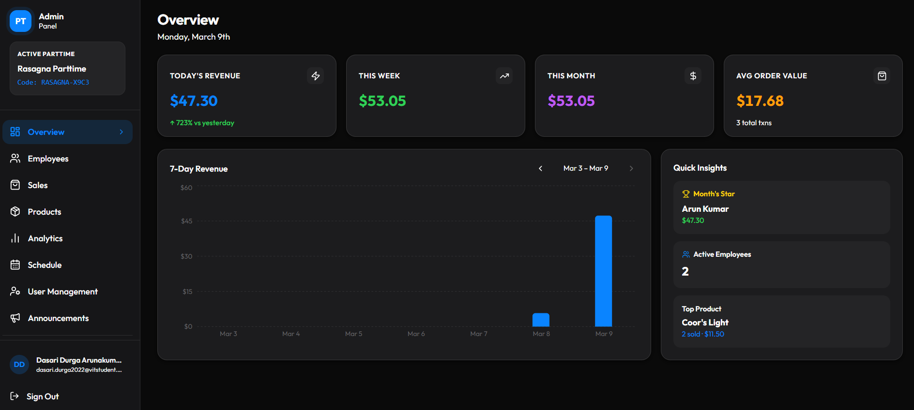</td>
    </tr>
    <tr>
      <td width="50%" align="center"><b>Product & Inventory Management</b></td>
      <td width="50%" align="center"><b>Sales Analytics & Revenue Charts</b></td>
    </tr>
    <tr>
      <td>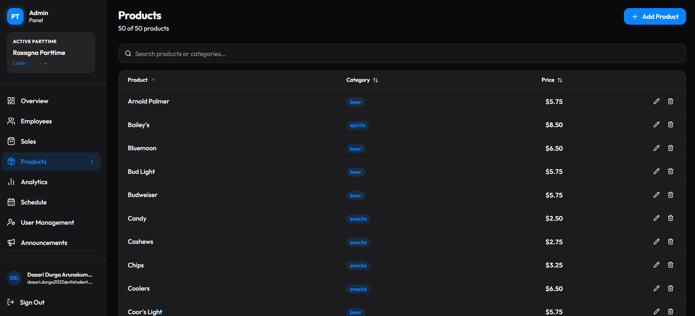</td>
      <td>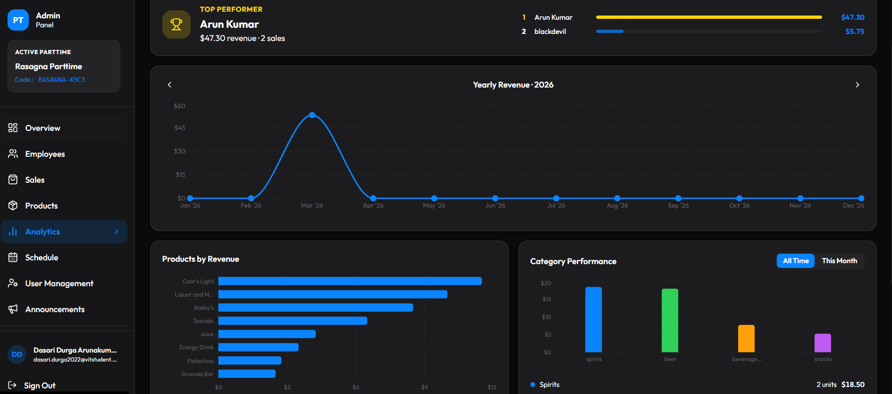</td>
    </tr>
    <tr>
      <td width="50%" align="center"><b>Sales Transactions & Audit Logs</b></td>
      <td width="50%" align="center"><b>Staff & Whitelist Management</b></td>
    </tr>
    <tr>
      <td>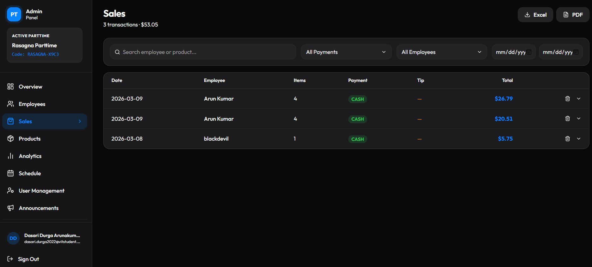</td>
      <td>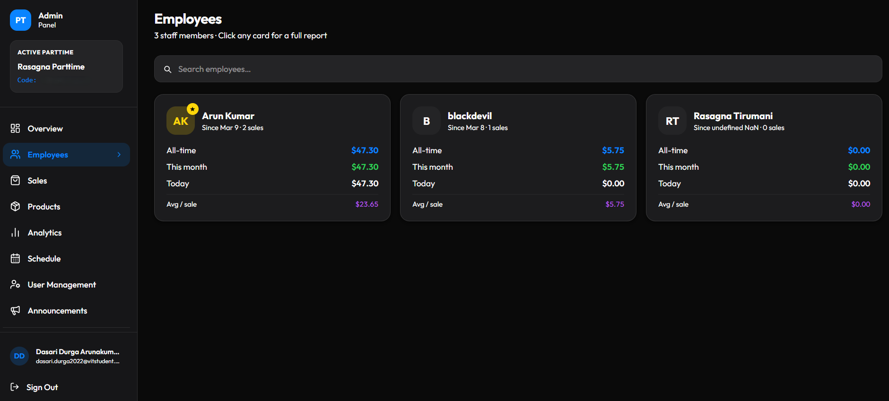</td>
    </tr>
  </table>
</div>

---

## 🏗️ Architecture & Data Flow

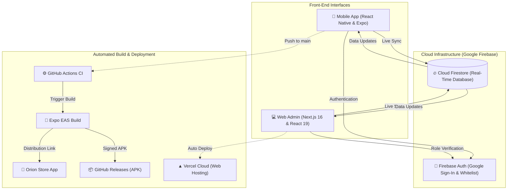

---

## 🛠️ Tech Stack

| Domain | Technology | Details / Purpose |
| :--- | :--- | :--- |
| **Mobile App** | [React Native 0.81](https://reactnative.dev/) | Cross-platform native mobile foundation with new architecture enabled |
| **Mobile Framework** | [Expo SDK 54](https://expo.dev/) | Managed runtime, EAS build system, Expo Router (file-based navigation) |
| **Mobile Styling** | [NativeWind v4](https://www.nativewind.dev/) | Tailwind CSS primitives compiled for React Native |
| **Mobile Data & Visuals** | `react-native-gifted-charts`, `react-native-calendars` | Interactive trend charts, shift calendar components |
| **Mobile Hardware & Files** | `expo-print`, `expo-sharing`, `expo-haptics` | Receipt printing, native sharing sheets, tactile haptic response |
| **Admin Web App** | [Next.js 16.1](https://nextjs.org/) | Modern React 19 framework using the App Router architecture |
| **Web Styling** | [Tailwind CSS v4](https://tailwindcss.com/) | High-performance CSS engine with modern theme tokens |
| **Admin Visuals & Icons** | [Recharts](https://recharts.org/), [Lucide React](https://lucide.dev/) | Interactive SVG analytics graphs and clean iconography |
| **Document Exporting** | `jspdf`, `jspdf-autotable`, `xlsx` | Client-side creation of formatted PDF receipts and Excel sheets |
| **Cloud Backend** | [Google Firebase](https://firebase.google.com/) | Cloud Firestore for low-latency sync & Firebase Authentication |
| **CI / CD Pipeline** | GitHub Actions & Expo EAS | Automated production Android APK compilation and GitHub Release publishing |
| **Hosting** | [Vercel](https://vercel.com/) | Global edge deployment for the Next.js web portal |

---

## 📁 Repository Structure

```text
Rasagna_Parttime/
├── .github/
│   └── workflows/
│       └── build-android.yml     # Automated CI/CD: EAS production APK build & GitHub release
├── admin/                        # Next.js 16 Web Admin Dashboard
│   ├── app/                      # App router pages (analytics, products, sales, schedule, users)
│   ├── lib/                      # Firebase setup, Firestore hooks, and auth providers
│   ├── public/                   # Static dashboard assets
│   ├── package.json              # Web dependencies
│   └── .env.example              # Template environment variables
├── mobile/                       # Expo / React Native Staff Application
│   ├── app/                      # Expo Router screens (tabs, admin routes, auth flow)
│   ├── assets/                   # App icons, splash screens, and adaptive vectors
│   ├── components/               # Reusable UI widgets, modals, and sheets
│   ├── context/                  # Global Auth & App state contexts
│   ├── hooks/                    # Firestore real-time data hooks (leaderboard, sales, admin)
│   ├── plugins/                  # Custom Expo config plugins
│   ├── app.config.js             # Dynamic Expo configuration & EAS project bindings
│   └── package.json              # Mobile dependencies
├── assets/                       # High-resolution screenshots and visuals for documentation
└── readme.md                     # Project documentation
```

---

## 🚀 Getting Started

Follow the steps below to run both the Web Admin portal and the Mobile POS app locally.

### 1. Prerequisites
- **Node.js**: v20.x or later installed
- **Package Manager**: `npm` or `yarn`
- **Expo CLI**: Installed globally or executed via `npx`
- **Firebase Project**: A Firebase project with **Authentication** (Email/Password or Google) and **Cloud Firestore** activated.

### 2. Clone the Repository
```bash
git clone https://github.com/ArunaK-netizen/Rasagna_Parttime.git
cd Rasagna_Parttime
```

---

### 3. Setup Web Admin Dashboard (`/admin`)

1. Change directory to the admin app:
   ```bash
   cd admin
   ```
2. Install dependencies:
   ```bash
   npm install
   ```
3. Configure environment variables:
   ```bash
   cp .env.example .env.local
   ```
4. Populate `.env.local` with your Firebase Web configuration:
   ```env
   NEXT_PUBLIC_FIREBASE_API_KEY=your_api_key_here
   NEXT_PUBLIC_FIREBASE_AUTH_DOMAIN=your_project_id.firebaseapp.com
   NEXT_PUBLIC_FIREBASE_PROJECT_ID=your_project_id
   NEXT_PUBLIC_FIREBASE_STORAGE_BUCKET=your_project_id.firebasestorage.app
   NEXT_PUBLIC_FIREBASE_MESSAGING_SENDER_ID=your_sender_id
   NEXT_PUBLIC_FIREBASE_APP_ID=your_app_id
   ```
5. Launch the local development server:
   ```bash
   npm run dev
   ```
   Open [http://localhost:3000](http://localhost:3000) in your browser.

---

### 4. Setup Mobile Application (`/mobile`)

1. Change directory to the mobile app:
   ```bash
   cd ../mobile
   ```
2. Install dependencies:
   ```bash
   npm install
   ```
3. Configure Firebase Credentials:
   - **Android**: Download `google-services.json` from your Firebase Console and place it in the `/mobile` root directory.
   - **iOS**: Download `GoogleService-Info.plist` and place it in `/mobile`.
   - **Web / Development**: Create a `.env.local` file in `/mobile`:
     ```env
     EXPO_PUBLIC_FIREBASE_API_KEY=your_api_key
     EXPO_PUBLIC_FIREBASE_AUTH_DOMAIN=your_project.firebaseapp.com
     EXPO_PUBLIC_FIREBASE_PROJECT_ID=your_project_id
     EXPO_PUBLIC_FIREBASE_STORAGE_BUCKET=your_project.appspot.com
     EXPO_PUBLIC_FIREBASE_MESSAGING_SENDER_ID=your_sender_id
     EXPO_PUBLIC_FIREBASE_APP_ID=your_app_id
     ```
4. Start the Expo development server:
   ```bash
   npx expo start
   ```
   - Press **`a`** to open on a connected Android device or emulator.
   - Press **`i`** to open in the iOS simulator.
   - Press **`w`** to run in a web browser.
   - Or scan the QR code with **Expo Go** or an Expo development client build.

---

## ⚙️ Environment Variables Summary

### Web Admin (`admin/.env.local`)
| Variable | Required | Description |
| :--- | :--- | :--- |
| `NEXT_PUBLIC_FIREBASE_API_KEY` | Yes | Firebase project Web API Key |
| `NEXT_PUBLIC_FIREBASE_AUTH_DOMAIN` | Yes | Firebase Auth domain (`*.firebaseapp.com`) |
| `NEXT_PUBLIC_FIREBASE_PROJECT_ID` | Yes | Google Cloud / Firebase project ID |
| `NEXT_PUBLIC_FIREBASE_STORAGE_BUCKET` | Yes | Default Cloud Storage bucket |
| `NEXT_PUBLIC_FIREBASE_MESSAGING_SENDER_ID` | Yes | Cloud Messaging sender ID |
| `NEXT_PUBLIC_FIREBASE_APP_ID` | Yes | Firebase Web application identifier |

### Mobile App (`mobile/.env.local` & Native Configs)
| File / Variable | Platform | Description |
| :--- | :--- | :--- |
| `google-services.json` | Android Native | Firebase Android configuration generated from console |
| `GoogleService-Info.plist` | iOS Native | Firebase iOS configuration generated from console |
| `EXPO_PUBLIC_FIREBASE_*` | Web / Expo Go | Mirror of Firebase credentials for Expo web & cross-platform fallbacks |

---

## 🔄 CI / CD Pipeline

The repository includes a turnkey GitHub Actions workflow (`.github/workflows/build-android.yml`) that automates production mobile builds:

1. **Trigger**: Automatically executes whenever changes are pushed to `mobile/**` on the `main` branch, or triggered manually via `workflow_dispatch`.
2. **EAS Build**: Compiles a production Android APK using Expo Application Services.
3. **Artifact Publishing**:
   - The compiled `.apk` binary is uploaded as a workflow artifact.
   - A new GitHub release (`build-<run_number>`) is created automatically with the attached binary on [Releases](https://github.com/ArunaK-netizen/Rasagna_Parttime/releases).
4. **App Distribution**:
   - The published build is synchronized with the [Orion Store](https://rookieenough.github.io/Orion-Data/redirect.html?id=parttime&icon=https%3A%2F%2Fraw.githubusercontent.com%2FArunaK-netizen%2FRasagna_Parttime%2Fmain%2Fmobile%2Fassets%2Fimages%2Ficon.png).

---

## 🛡️ Security & Access Control

- **Request & Whitelist System**: Anyone who downloads the app must log in and submit an access request. They are placed in a quarantined "Pending" state until an authorized administrator verifies them in the Web Portal.
- **Role Isolation**: Admin capabilities (e.g. modifying prices, approving users, viewing full employee lists) are protected both in UI state and Firebase Firestore security rules.
- **Tenant Separation**: Data is segmented under store scopes (`parttimes/{parttimeId}`) to allow multi-tenant isolation.

---

## 📄 License

This project is licensed under the [MIT License](LICENSE).

---

<div align="center">
  <sub>Built with ❤️ for modern retail operations and agile teams.</sub>
</div>
